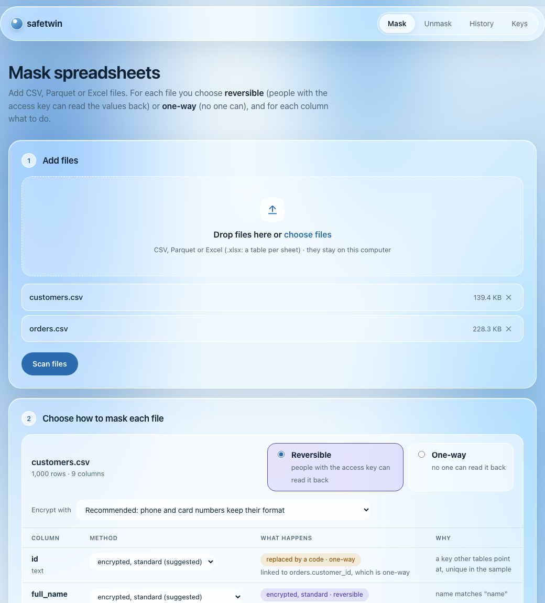
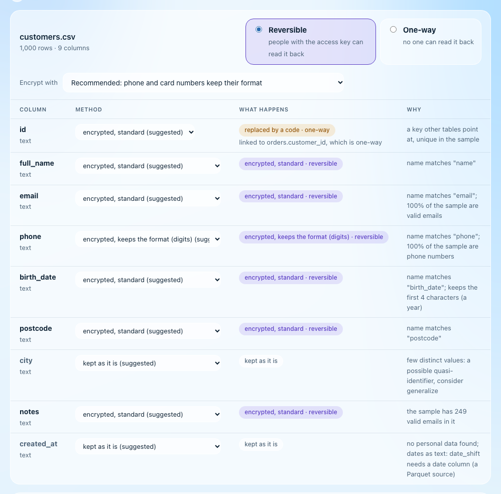
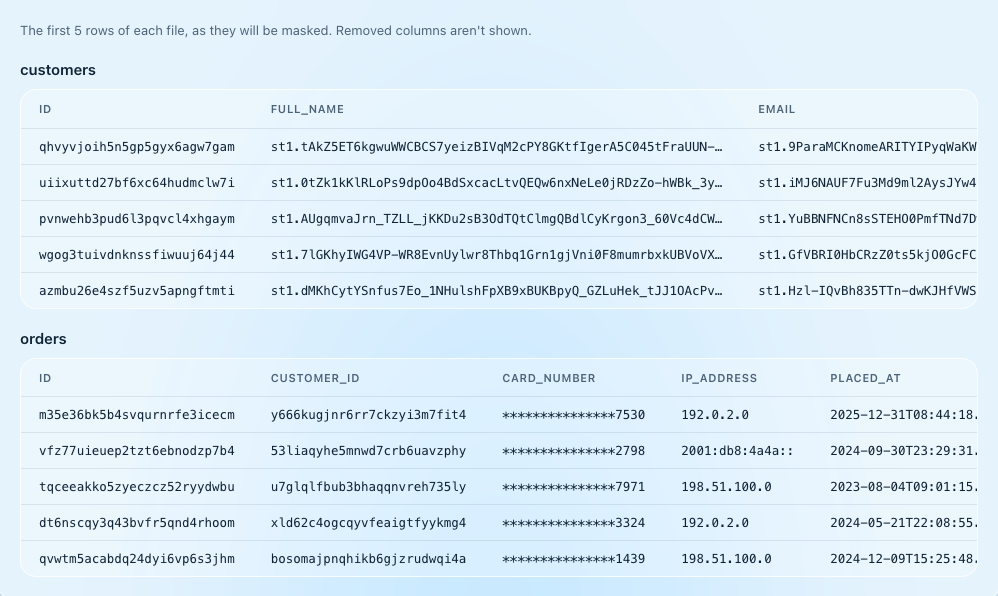
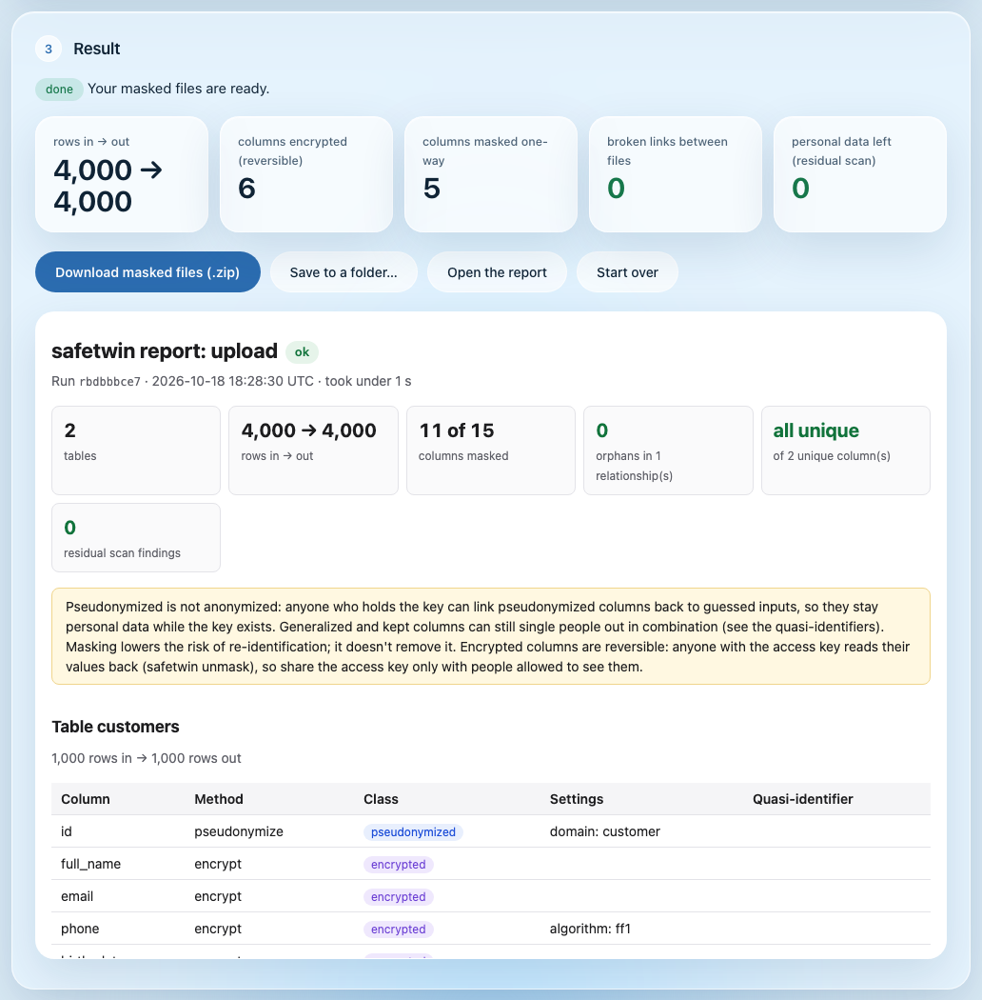
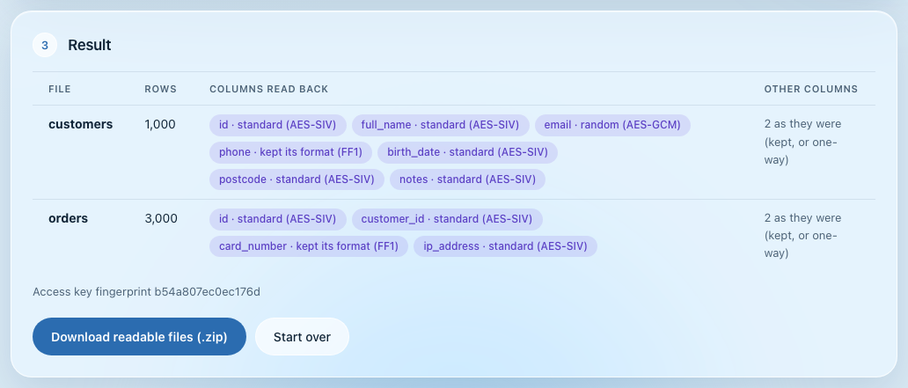
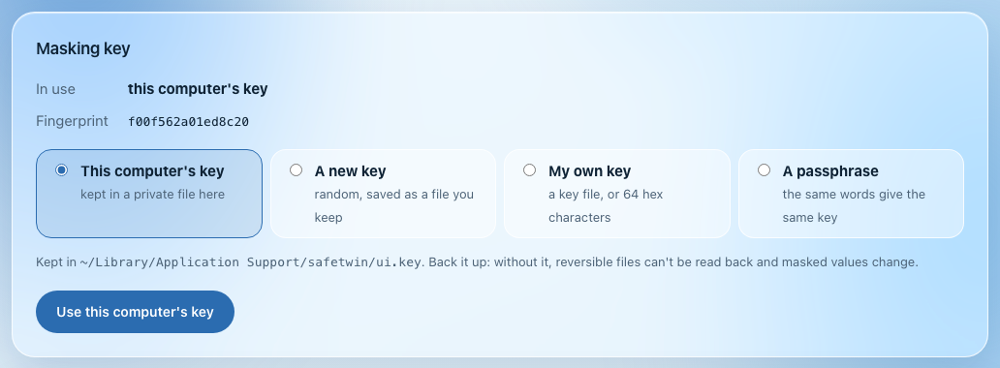
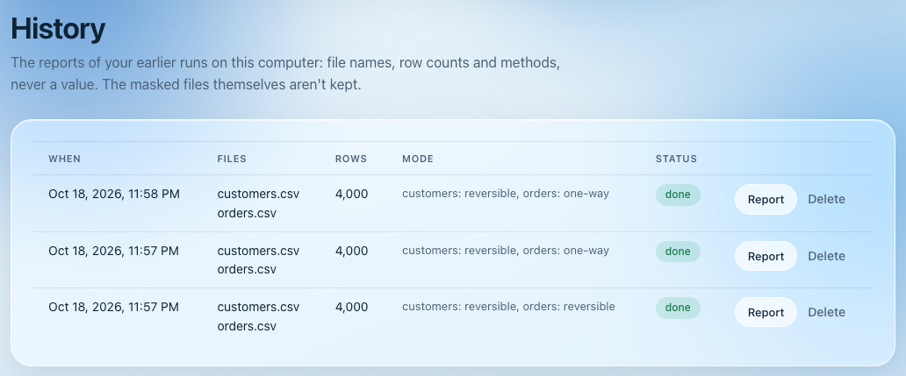

# safetwin

**Safe twins of your production data.** safetwin turns a production data dump into a realistic,
privacy-safe copy for development, testing and CI. Joins stay intact, every run writes a report you can
check, and the whole job can be exported as a plain Polars script that runs without safetwin.

**Final release: 1.0.0.** safetwin is complete and tested on macOS and Linux; no further development is
planned. You're welcome to use it as it is, or fork it under the MIT license.

[](https://github.com/Shirish-012/safetwin/actions/workflows/ci.yml)
[](LICENSE)

-brightgreen.svg)

<picture>
  <source media="(prefers-color-scheme: dark)" srcset="docs/images/app-dark.png">
  
</picture>

## Contents

- [What it does](#what-it-does)
- [Screenshots](#screenshots)
- [Install](#install)
- [Quick start](#quick-start)
- [The page: `safetwin ui`](#the-page-safetwin-ui)
- [The command line](#the-command-line)
- [Measured](#measured)
- [Limits](#limits)
- [Documentation](#documentation)
- [Contributing](#contributing)
- [License](#license)

## What it does

- **Joins that survive.** Keyed pseudonyms (HMAC-SHA-256) are the same per key and domain, so
  `orders.customer_id` still matches `customers.id`, across files, tables and runs.
- **Reversible when you want it.** Choose per file. Reversible columns are encrypted with standard ciphers
  (AES-256-SIV, AES-256-GCM, or FF1, which keeps a card number's format), so the people you give the access
  key to can read them back. One-way columns can't be read back by anyone.
- **Smaller twins that still join.** A subset of the root rows, with every row they point at: 0 orphans,
  checked.
- **A report you can check.** Methods, row counts, foreign-key integrity, uniqueness, a re-scan of the
  output for leftover personal data, and the SHA-256 of every file. A failed check leaves no twin.
- **Nothing left behind.** No data value in logs, messages, temp files or caches, checked by leak tests.
- **Code you own.** `safetwin export` writes a readable Polars script, tested to write exactly the same
  twin.
- **Your data, where it is.** Folders of CSV, Parquet and Excel files, and Postgres schemas. macOS and
  Linux.

## Screenshots

| | |
|---|---|
| **Choose per file and per column.** Reversible or one-way for each file; the suggested method for each column, with the reason.  | **Preview before you run.** The first rows of every file, as they will come out.  |
| **A result you can check.** Rows in and out, broken links, leftover personal data, and the full report.  | **Read reversible files back.** Each column's cipher is detected; nothing to choose by hand.  |
| **Keys your way.** This computer's key, a new one, your own key file, or a passphrase.  | **History.** Earlier runs and their reports; never a value.  |

## Install

You need Python 3.12 or later (`python3 --version` tells; macOS comes with an older one: `brew install
python@3.12`, or the installer from [python.org](https://www.python.org/downloads/)). Get the code, or
download the zip from GitHub and unpack it, then install it in its folder:

```bash
git clone https://github.com/Shirish-012/safetwin.git && cd safetwin
python3.12 -m venv .venv          # a private Python environment (or python3, if it is 3.12+)
source .venv/bin/activate
pip install .                     # about a minute
safetwin --version
```

Next time, `source .venv/bin/activate` in this folder is enough. Without cloning:
`pip install "git+https://github.com/Shirish-012/safetwin"`. With Docker: `docker build -t safetwin .`, then
`docker run --rm -v "$PWD:/work" -e SAFETWIN_KEY safetwin --help`.

## Quick start

On a made-up shop with planted personal data:

<!-- quickstart:start -->
```bash
pip install .                                      # in this folder (see Install above)
safetwin demo try && cd try                        # a made-up shop: customers and orders, with planted PII
export SAFETWIN_KEY=$(safetwin key new --print)    # a new key: keep real ones in a secret store
safetwin scan data -o masking.yaml                 # a draft policy: a method per column, with the reasons
safetwin check masking.yaml                        # every column named, every method fits its column
safetwin mask masking.yaml                         # the twin in ./safe, with report.json and report.html
safetwin export masking.yaml --to polars -o mask_shop.py   # the same job as a plain Polars script...
python mask_shop.py --target safe-from-script              # ...that writes exactly the same twin
```
<!-- quickstart:end -->

Open `masking.yaml` to see what was chosen and why, and `safe/report.html` for what the run proves.
`scripts/smoke.sh` runs this block as written, from a fresh install.

## The page: `safetwin ui`

```bash
safetwin ui
```

opens a page in your browser, served from your own computer (nothing leaves it).

1. **Mask:** drop in CSV, Parquet or Excel files. For each file choose **reversible** or **one-way**;
   *Encrypt with* sets every column of a reversible file at once, and any column can still be changed.
   **Preview**, then **Mask files**, with progress.
2. **Unmask:** drop in reversible files (and the `report.json` from the same zip) with the access key; you
   get the readable files back.
3. **History:** the reports of earlier runs.
4. **Keys:** mask with this computer's key, a new key, your own key file, or a passphrase; download the
   access key for the people who may read reversible files (share it like a password).

**Getting the masked data:** *Download masked files (.zip)* gives one file per table, the report and the
policy used. *Save to a folder…* puts the zip in a Google Drive, Dropbox, OneDrive or iCloud folder that is
synced on this computer; with no sync app, download the zip and drag it into
[drive.google.com](https://drive.google.com).

Stop the page with Ctrl-C; the files you added are deleted then. Back up the page's key
(`~/Library/Application Support/safetwin/ui.key` on macOS, `~/.local/share/safetwin/ui.key` on Linux):
without it, reversible files can't be read back.

## The command line

```bash
safetwin key new --file ~/.config/safetwin/shop.key   # 32 random bytes, mode 0600
safetwin scan ./prod_dump -o masking.yaml --key file://~/.config/safetwin/shop.key
$EDITOR masking.yaml                                  # review every column: detection only suggests
safetwin mask masking.yaml --out ./safe
```

The policy is a YAML file you keep in git. It names a method for every column; a column it doesn't name
stops the run.

```yaml
apiVersion: safetwin/v1
kind: MaskingPolicy
metadata: { name: shop-to-staging }
spec:
  source: { folder: ./prod_dump, format: parquet }
  target: { folder: ./safe, format: parquet }
  key: file://~/.config/safetwin/shop.key        # a reference; the key itself is never in the file
  tables:
    customers:
      id:         { method: pseudonymize, domain: customer }   # still an integer, still joins
      email:      { method: fake, kind: email }                # same input → same fake email
      phone:      { method: encrypt, algorithm: ff1 }          # reversible, keeps its format
      birth_date: { method: generalize, to: year }
      notes:      drop
      city:       keep
    orders:
      customer_id: { method: pseudonymize, domain: customer }  # joins to customers.id
      placed_at:   { method: date_shift, entity: customer_id }
      card_number: { method: redact, keep_last: 4 }
  relationships:
    - orders.customer_id -> customers.id
  subset: { root: customers, fraction: 0.10 }   # optional: 10% of customers and every row they need
```

The methods are `keep`, `pseudonymize`, `fake`, `generalize`, `date_shift`, `redact`, `null`, `drop` and
the reversible `encrypt`.

| To… | Run |
|-----|-----|
| Mask a Postgres schema (its foreign keys become the relationships) | `safetwin scan --postgres env://PROD_URL --schema public -o masking.yaml` |
| Mask Excel workbooks (a table per sheet) | `safetwin scan ./workbooks --format xlsx -o masking.yaml` |
| Draft every masked column reversible | `safetwin scan ./data --reversible --algorithm auto -o masking.yaml` |
| Read reversible columns back | `safetwin unmask ./safe --key file://access.key --out readable` |
| Write the access key for others | `safetwin key access masking.yaml --file access.key` |
| Re-encrypt under a new access key | `safetwin rekey ./safe --out ./safe-new --from file://old.key --to file://new.key` |
| Make a key from a passphrase | `safetwin key from-passphrase --file team.key` |
| Get the job as a Polars script | `safetwin export masking.yaml --to polars -o mask.py` |

In CI, run the exported script (it needs only Python and Polars), the container
(`docker run --rm -v "$PWD:/work" -e SAFETWIN_KEY safetwin mask masking.yaml`), or the GitHub Action:

```yaml
- uses: Shirish-012/safetwin@main
  with:
    policy: masking.yaml
  env:
    SAFETWIN_KEY: ${{ secrets.SAFETWIN_KEY }}
```

## Measured

On an Apple M4 with 16 GB, October 2026, by the tests named:

| What | Result | Test |
|------|--------|------|
| Pseudonymization, distinct values, one core | about 1.7M integers/s, 1.0M strings/s | `tests/masking/test_perf.py` |
| A masking stage vs a hand-written Polars script (153 MB CSV → Parquet) | 1.04× | `tests/dataplane/test_perf.py` |
| 4 GB of CSV through the same path | 10.5 s, memory growth at most 282 MB | same file, opt-in (`SAFETWIN_BIG_GB=4`) |
| Exported script vs `safetwin mask` | identical tables, schemas and row order | `tests/masking/test_export.py` |

## Limits

- CSV columns are read as text, so dates in CSV can't be date-shifted (Parquet, Excel and Postgres keep
  the types). A Postgres or Excel source is copied to a private local folder for the run.
- `safetwin export` writes a script for file sources and targets only, not for Postgres or Excel.
- Detection is heuristic (names, validators, shapes): it suggests; you decide, column by column.
- Pseudonymized data is still personal data under GDPR while the key exists. Encrypted columns are
  readable by anyone with the access key: treat a reversible twin as the real data.
- `safetwin ui` suits files up to a few GB; use the command line for bigger ones. Excel is `.xlsx` only.

## Documentation

| Doc | What it covers |
|-----|----------------|
| [docs/guide.md](docs/guide.md) | The page and every command, sources and targets, the policy and its methods, the report, export |
| [docs/security.md](docs/security.md) | Keys and encryption (and decrypting outside safetwin), privacy and security, what stays stable |
| [docs/internals.md](docs/internals.md) | Architecture, testing, and the decisions behind them |
| [CHANGELOG.md](CHANGELOG.md) | What changed in each version |

## Contributing

```bash
scripts/bootstrap.sh     # .venv with the package, the CLI and the dev tools
scripts/check.sh         # lint, types, schema drift, tests (add --perf for the benchmarks)
scripts/smoke.sh         # the quick start above, from a fresh install
```

See [CONTRIBUTING.md](CONTRIBUTING.md). Report security problems privately: [SECURITY.md](SECURITY.md).

## License

[MIT](LICENSE). Built with Python, Polars, DuckDB, PyArrow, Pydantic, Typer and pyca/cryptography.
